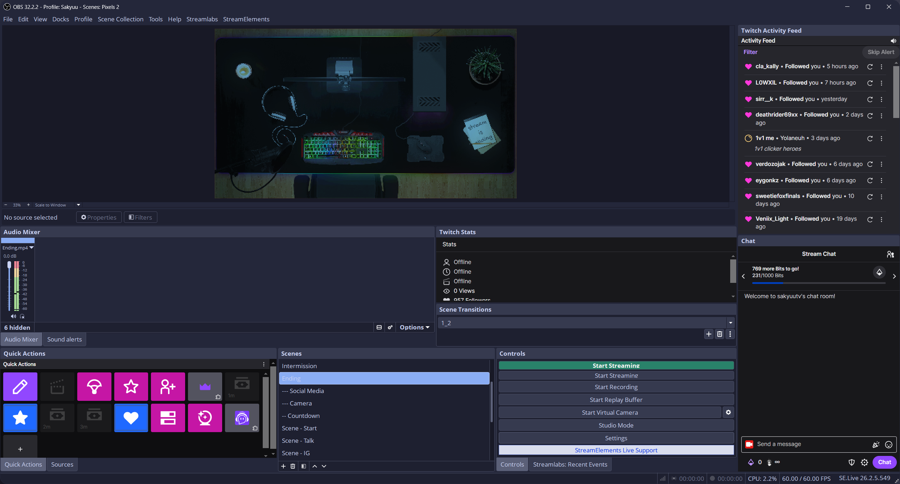

# OBS Studio Catppuccin Macchiato Theme

A **Catppuccin Macchiato inspired dark theme for OBS Studio**, based on the **Yami Default** theme.

## Why I made this

I wanted an OBS Studio theme that matched the aesthetic of **Catppuccin Macchiato**, one of my favorite dark color palettes.

I decided to adapt the style to OBS Studio while keeping the original Yami Default appearance and replacing its color palette with colors inspired by **Catppuccin Macchiato**.

This theme was created with the help of AI and is designed to provide a consistent, comfortable dark interface while staying close to the original OBS Studio theme structure.

> **Recommendation:** For the intended look, I recommend using this theme with **Windows Dark Mode enabled**.

## Installation

### Windows

1. Download the theme files from this repository.
2. Open your OBS Studio themes folder:

```text
C:\Program Files\obs-studio\data\obs-studio\themes\
```

3. Drag and drop the downloaded theme files into the `themes` folder.
4. If Windows asks whether you want to replace existing files, confirm it.
5. Restart OBS Studio.

> If your OBS Studio installation is located somewhere else, open your OBS installation directory and navigate to `data\\obs-studio\\themes\\`.

### Enable Catppuccin Macchiato

Once the files are installed:

1. Open **OBS Studio**.
2. Go to **Settings → Appearance**.
3. Select **Yami Default** as the theme.
4. Select **Catppuccin Macchiato** as the theme variant.
5. Click **Apply** or **OK**.

For the best match with the intended aesthetic, also make sure **Windows Dark Mode** is enabled.

That's it. Your OBS Studio interface should now use the Catppuccin Macchiato inspired color palette.

## Preview



> The preview is intended to showcase the theme using the **Catppuccin Macchiato** color palette.

## Credits

* **Catppuccin:** The color palette and visual inspiration are based on the [Catppuccin](https://github.com/catppuccin/catppuccin) project.
* **Yami Default:** Original OBS Studio theme developed by [Warchamp7](https://github.com/Warchamp7).
* This OBS Studio theme was created with AI assistance.

## Notes

This project is a color customization of the existing Yami Default theme. It does not aim to replace the original OBS Studio theme.

The theme is primarily designed around the **Catppuccin Macchiato** aesthetic and works best when paired with **Windows Dark Mode**.

If you encounter any issues or have suggestions for improvements, feel free to open an issue on this repository.
